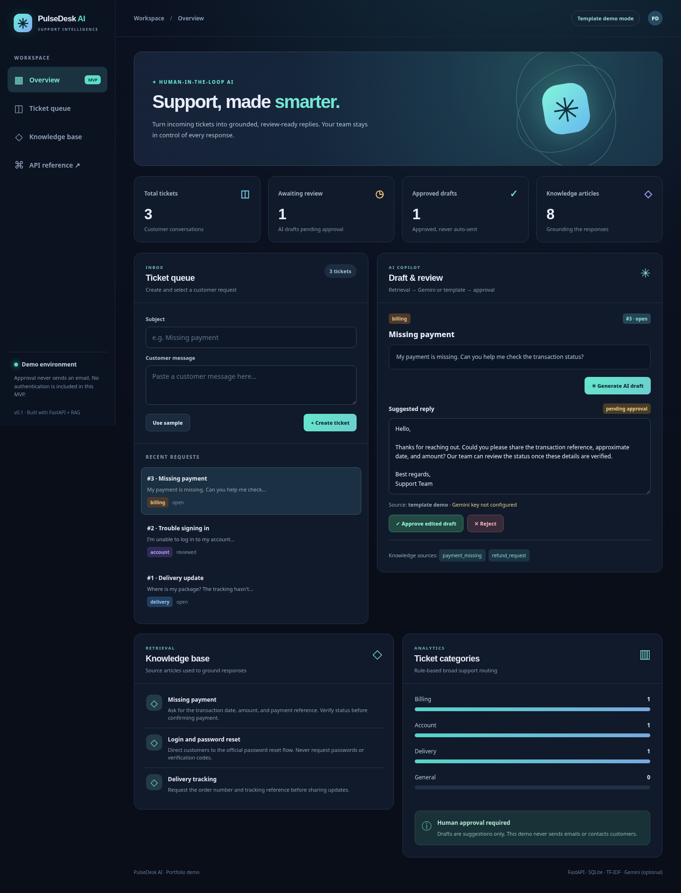
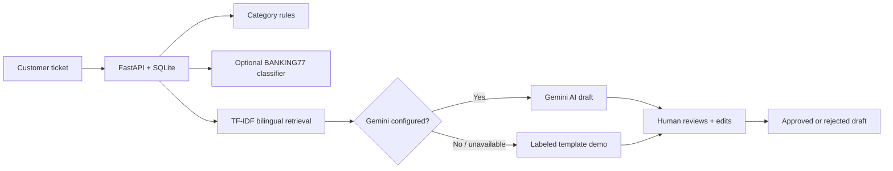

# PulseDesk AI

**A human-in-the-loop AI customer-support workspace** built with **FastAPI, SQLite, TF-IDF retrieval, optional BANKING77 intent classification, and Google Gemini**. Create support tickets, retrieve relevant knowledge, generate suggested replies, edit and approve them, and explore dashboard metrics.



*Illustrative UI preview with synthetic data, not evidence of a live Gemini call.*

> **Project status:** Working **portfolio MVP / demo**, **not production-ready SaaS**. No authentication, multi-tenancy, email delivery, or deployment is included. **Approving a draft never sends it to a customer.**

## What it looks like

A responsive dark dashboard is served directly from FastAPI at `http://127.0.0.1:8002/`. Open it in your browser, click **Use sample**, then **Create ticket → Generate AI draft → Approve edited draft**.

### Features

- **Ticket intake:** Save and review customer messages in local SQLite.
- **Classification:** Explainable rule-based broad categories (`billing`, `account`, `delivery`, `general`).
- **Optional trained classifier:** Load a **separate BANKING77 intent model** from `backend/ml/data/ticket_model.joblib` if available. Its intent and probability are shown separately from broad support categories.
- **Knowledge retrieval:** Character n-gram TF-IDF search over 8 sample English/Arabic knowledge articles; source IDs appear with drafts. This is a transparent **basic retrieval baseline**, not an embeddings-based vector database.
- **Gemini drafting (optional):** Uses `gemini-3.8-flash` when a valid API key is configured. The key is read at request time, so missing keys do **not** prevent FastAPI startup.
- **Outage-safe demo mode:** Without a key, or when an external call fails, the app produces a **clearly labeled template draft** instead of pretending Gemini worked.
- **Human review:** Edit, approve or reject persisted drafts; reviewed drafts cannot be reviewed twice.
- **Analytics:** Live ticket and draft counts and support category breakdown.
- **Tests + CI:** Seven offline integration and mocked-provider tests and GitHub Actions workflow.

## Architecture



**No email-sending action is implemented.** All customer messages in this app are demo/local unless you enter real data yourself. Avoid entering sensitive customer information in a demo.

## Run locally — Windows PowerShell

Requires Python 3.11+ (tested against the Python available in this project environment). From the project root:

```powershell
python -m pip install -r requirements.txt
python -m uvicorn backend.main:app --port 8002
```

Open **http://127.0.0.1:8002/** for the dashboard or **http://127.0.0.1:8002/docs** for API documentation.

**No key needed for the first demo.** The UI should say **Template demo mode** and the workflow remains fully testable.

### Enable Gemini (optional)

In the **same PowerShell terminal before starting the server**, set the key privately:

```powershell
$env:GEMINI_API_KEY = [System.Net.NetworkCredential]::new("", (Read-Host "New Gemini API key" -AsSecureString)).Password
python -m uvicorn backend.main:app --port 8002
```

This environment variable only applies to the current terminal session. You can get a key from [Google AI Studio](https://aistudio.google.com/api-keys). **Never paste keys into GitHub, screenshots, or support chats. Revoke any key that has been exposed.** Gemini availability and quotas depend on your account; if the service is busy, the app visibly falls back to template mode.

The model ID can be changed by setting `GEMINI_MODEL` (default `gemini-3.8-flash`). The current Gemini Python client convention is described in the [official SDK documentation](https://googleapis.github.io/python-genai/).

## Run tests

```powershell
python -m pip install -r requirements-dev.txt
python -m pytest -q
```

Tests (including mocked Gemini success/outage behavior) are designed to run without Gemini credentials, a trained model, or network access. The sample knowledge is local.

## Quick API example

With the app running, use a **second** PowerShell terminal:

```powershell
Invoke-RestMethod -Uri "http://127.0.0.1:8002/ai/draft" -Method Post -ContentType "application/json" -Body '{"subject":"Missing payment","message":"My payment is missing. Can you help?"}'
```

This returns `draft`, `provider`, `sources`, `warning`, and `status: pending_approval`. The standalone `/ai/draft` route is provided for compatibility; use ticket-specific routes for persistent review.

| Endpoint | Method | Purpose |
|---|---|---|
| `/api/health` | GET | Status (does not reveal credentials) |
| `/api/tickets` | GET / POST | List and create tickets |
| `/api/tickets/{id}` | GET | Ticket and its drafts |
| `/api/tickets/{id}/draft` | POST | Create a reviewable draft |
| `/api/drafts/{id}/review` | POST | Approve/reject; optional edits |
| `/api/knowledge` | GET | List knowledge articles |
| `/api/knowledge/search?question=...` | GET | Retrieve relevant passages |
| `/api/metrics` | GET | Ticket/draft metrics |
| `/ai/draft` | POST | Ad hoc draft (not saved) |

Example review JSON: `{"decision":"approve","edited_text":"Thanks for contacting us..."}`. Valid decisions: `approve` or `reject`.

## Optional BANKING77 ML model

The original project trained a TF-IDF + logistic regression model on **BANKING77**. Its training data and serialized artifact were **not included in the source archive** and are therefore not present in this repo. This version starts without them.

If you own a compatible, trusted model, place it at `backend/ml/data/ticket_model.joblib`, then restart the server. **Never load joblib artifacts from untrusted sources.** To retrain from data you are licensed to use:

1. Place `train.csv` and `test.csv` in `backend/ml/data/` with `text,category` columns.
2. Run `python -m backend.ml.train_model`.
3. Restart FastAPI.

The BANKING77 model predicts **banking-specific intents**, not general ticket categories. The UI labels it accordingly; broad routing categories are separately rule-based. **No accuracy figures are claimed without a reproducible evaluation artifact.**

## Project structure

```text
backend/
  main.py                 API routes and request validation
  database.py             SQLite SQLAlchemy models
  ai/
    knowledge.json        Sample bilingual company knowledge
    retriever.py          TF-IDF relevance ranking
    draft_reply.py        Gemini prompt, generation, labeled fallback
  ml/
    predict.py            Broad categories + optional BANKING77 classifier
    train_model.py        Training script (bring your own licensed data)
  static/
    index.html            Responsive dashboard
    styles.css
    app.js
tests/test_api.py         Offline workflow tests
.github/workflows/ci.yml  GitHub Actions tests
docs/PORTFOLIO_COPY.md     Suggested LinkedIn, Mercor, profile descriptions
```

## Security and current limitations

This portfolio demo does **not** include: authentication/authorization, multi-tenant isolation, fine-tuning, background jobs, audit logs, rate limiting, real email integration, data encryption at rest, migrations, vector embeddings, prompt-injection resilience, or a production deployment. The source knowledge is a small hardcoded JSON set, not an enterprise document index. The template fallback is **not** an LLM-generated response. Gemini requests send entered ticket text to a third-party API when configured, so use **synthetic data** for demonstrations.

Before deploying a public SaaS, add authentication, strong authorization, rate limits, a migration tool, privacy protections, observability, and real-world retrieval/LLM evaluation.

## Portfolio talking points

- Took an initial FastAPI proof of concept and implemented a complete local **ticket → retrieval → AI suggestion → human review** workflow.
- Added honest provenance labeling so demos distinguish Gemini outputs from template fallbacks.
- Kept optional banking-intent ML separate from general ticket-routing logic.
- Built a responsive zero-build frontend and offline integration tests.

MIT licensed. See `LICENSE`.
